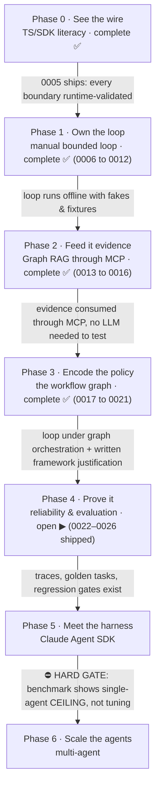
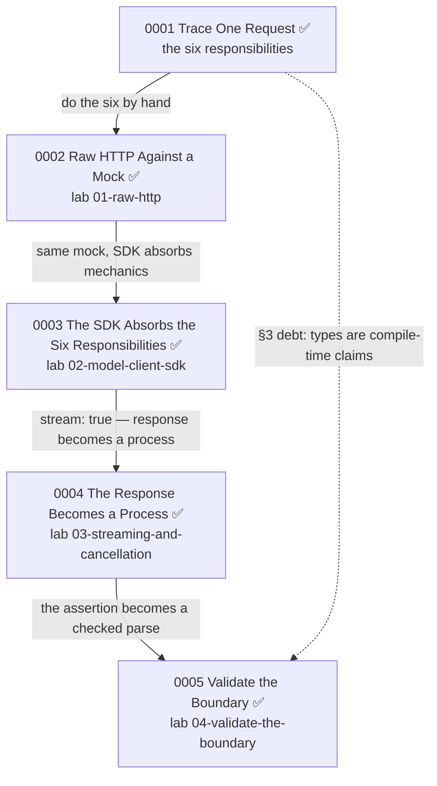
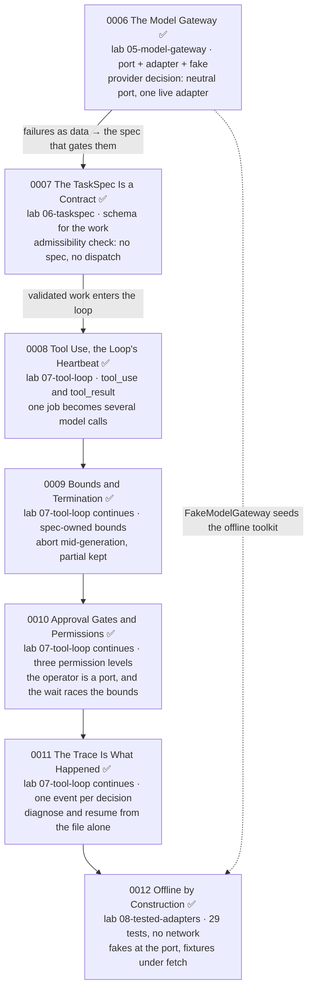
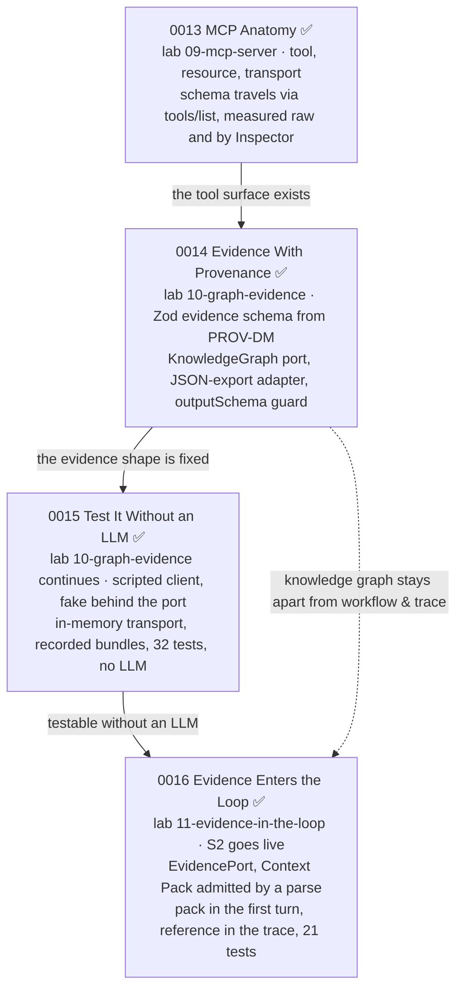
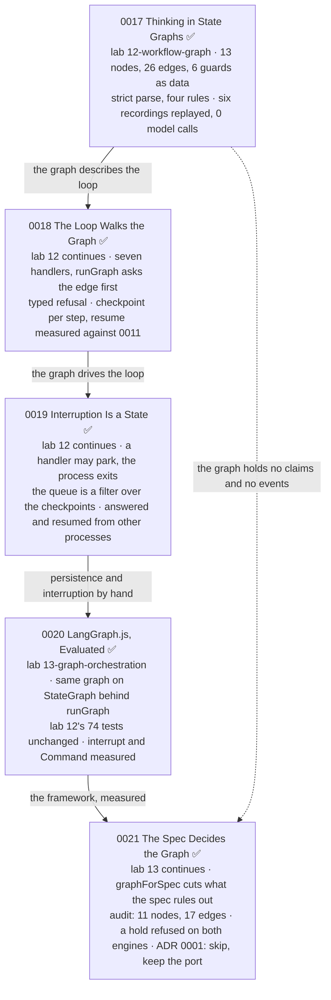
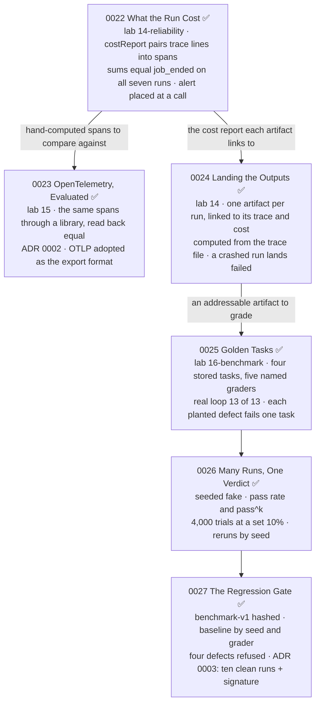
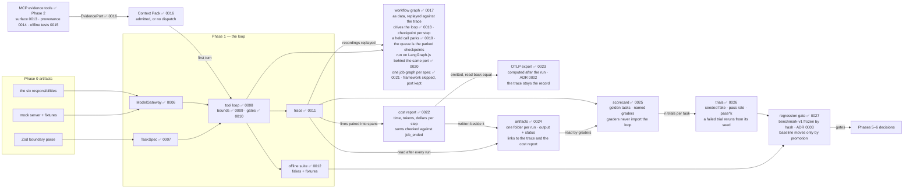

# Module graphs

Graph form of [ROADMAP.md](../../ROADMAP.md): the phases, their gates, and the lesson modules inside the open phase. **Sync duty:** when a lesson ships or a phase opens, update ROADMAP.md *and* this note in the same session. The roadmap's firmness gradient applies here too: shipped = history, next lesson = firm, everything further = provisional.

## The phase graph (gates are edges)

## Phase 0, module detail

Lesson maps: [[lesson-0001-trace-one-request]] · [[lesson-0002-raw-http-against-a-mock]] · [[lesson-0003-the-sdk-absorbs-the-six]] · [[lesson-0004-the-response-becomes-a-process]] · [[lesson-0005-validate-the-boundary]]

## Phase 1, module detail

Lesson maps: [[lesson-0006-the-model-gateway]] · [[lesson-0007-the-taskspec-is-a-contract]] · [[lesson-0008-tool-use-the-loops-heartbeat]] · [[lesson-0009-bounds-and-termination]] · [[lesson-0010-approval-gates-and-permissions]] · [[lesson-0011-the-trace-is-what-happened]] · [[lesson-0012-offline-by-construction]].

Supplements: 0006a has no map note, so see [[course-architecture]]. [[lesson-0006b-the-hermes-control-plane]] covers the Hermes OS control plane from the governance record. Read 0006 §1 first, then 0006b, then 0006a, then the rest.

## Phase 2, module detail

Opened 2026-09-02, complete 2026-09-30.

Lesson maps: [[lesson-0013-mcp-anatomy]] · [[lesson-0014-evidence-with-provenance]] · [[lesson-0015-test-it-without-an-llm]] · [[lesson-0016-evidence-enters-the-loop]].

## Phase 3, module detail

Opened 2026-10-06, complete 2026-10-30. Exit met by 0020 (the loop under graph orchestration) and 0021 (the written framework decision, `docs/adr/0001-skip-langgraph-js-keep-the-port.md`).

Lesson maps: [[lesson-0017-thinking-in-state-graphs]] · [[lesson-0018-the-loop-walks-the-graph]] · [[lesson-0019-interruption-is-a-state]] · [[lesson-0020-langgraph-js-evaluated]] · [[lesson-0021-the-spec-decides-the-graph]].

## Phase 4, module detail

Opened 2026-10-30. Shipped rows are history. The next row is firm, and the rest are provisional, per [ROADMAP.md](../../ROADMAP.md).

Lesson maps: [[lesson-0022-what-the-run-cost]] · [[lesson-0023-opentelemetry-evaluated]] · [[lesson-0024-landing-the-outputs]] · [[lesson-0025-golden-tasks]] · [[lesson-0026-many-runs-one-verdict]] · [[lesson-0027-the-regression-gate]].

## What accumulates (artifacts → the loop)

Each module leaves an artifact that a later module consumes.

Scenario steps these feed (see [[hermes-integration]]):

| Step | Where the course builds it |
|---|---|
| S1 (the envelope check) | Phase 0's boundary parse, then Phase 1's TaskSpec |
| S2 (evidence assembled) | Phase 2, over MCP — served since lesson 0013, with provenance since 0014. A client reads it under test since 0015. The loop plans from an admitted Context Pack since 0016 |
| S3 (dispatch under the graph) | Phase 3. The graph exists as data since lesson 0017 and drives the loop since 0018. A move it lacks is refused before it happens, and a checkpoint is written per step. Since 0019 a run can stand at a node with no process behind it. Since 0020 LangGraph.js can run it behind the same signature, with the guards still asked by Hermes's code. Since 0021 each job runs under a graph built from its spec, and ADR 0001 keeps lab 12's interpreter as the engine |
| S4 (model calls) | Phase 0's mechanics, below Phase 1's port |
| S5 (the loop iterates) | Phase 1, from lesson 0008, with the approval gate since lesson 0010. Since lesson 0019 a held call parks the run, and the queue is the checkpoints at `awaiting_approval`, answered from any process |
| S6 (budget enforcement) | Phase 0's cancellation, enforced by lesson 0009's bounds. Since lesson 0022 the 80% alert is placed at the call that crossed it, read back from the trace |
| S7 (the durable record) | Phase 1 since lesson 0011, deepened in Phase 4. Lesson 0018's checkpoint is a separate record under S3, not part of the trace. Since lesson 0022 a cost report is computed from the trace and checked against it, a view and never a second record. Since lesson 0023 the same spans export as OTLP, read back equal, with new ids on every export (ADR 0002) |
| S8 (landing the outputs) | Phase 4. Since lesson 0024 every run lands one folder under `artifacts/<run>/`, computed from its trace file. It holds the output, a status of done or failed, and links to the trace and the cost report. A crashed run lands failed, and a parked run lands when it ends |
| S9 (scoring the run) | Phase 4. Since lesson 0025 four golden tasks run offline through any loop with `startJob`'s shape. Five graders read only the landed artifact, the trace and the task, and a scorecard records every grade. Since lesson 0026 each task runs n times on a seeded fake, and `trials.json` reports pass rate and pass^k; a failed trial reruns from its seed. Since lesson 0027 a committed baseline for `benchmark-v1` refuses any trial failure it does not list, and moves only after ten clean runs and an accepted ADR (ADR 0003) |
