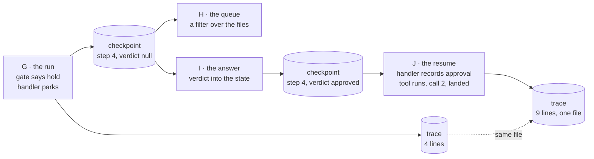

# Lesson 0019 — Interruption Is a State

The handler for `awaiting_approval` may return a park instead of a move. The run becomes a [[parked-run|parked run]], stopped at the node with the [[checkpoint]] as its only record and no process behind it. The [[approval-queue|approval queue]] is the set of such checkpoints. A second process writes the operator's verdict into the checkpoint's state. A third resumes the run, records the `approval` event, and continues the same trace file. The graph file and the six guards do not change.

Material: [open the lesson](../../lessons/0019-interruption-is-a-state.html) · lab: `hermes-sdk-lab/12-workflow-graph/`, parts G to J.

## Four processes, two files



Measured against zod 4.4.3 and vitest 3.2.7 on Node 22.14.0, on 2026-10-13, each part in its own shell:

- Part G: the held audit parks at step 4, node `awaiting_approval`, after 1 of 2 scripted model calls, with four trace lines.
- Part G: the same audit with nothing held lands at step 7 under the same wiring and never visits the node.
- Part H: two checkpoint files parsed, one waiting.
- Part I: the verdict goes into the checkpoint's state, and the trace file is untouched.
- Part J: landed, 2 model calls, 80 tokens, the same numbers as lesson 0018's in-process resume.

Resumed before any answer, the run parks again at step 4 and writes nothing. An answer for the landed job is refused with "the job stands at landed, not at awaiting_approval". The whole trace is nine lines in one file and walks legal and complete. The gap between the `gate` line and the `approval` line was 19 seconds in the recorded run, and 9 in a second one.

Mutation: with the park check in the interpreter replaced by a throw, 8 tests fail. With the verdict-in-state branch of the handler disabled, 2 fail. Restored, 74 pass. The suite holds 74 tests in nine files, 17 of them new. Exercise 08's 29 and exercise 11's 21 were re-run green, and all twelve packages typecheck.

## Hermes anchoring

Scenario step S5 (the loop iterates) says a held writeback call queues for the operator. The queue is now a directory of checkpoints, readable and answerable by any process. S3 (dispatch under the graph) is unchanged: the gate is still the edge `gating > awaiting_approval` with the guard `gate_held`, drawn in lesson 0017. The trace holds what happened, and it cannot tell that three processes wrote it. Operator approval as a Hermes gate (H4) is a proposed clarification in `hermes-job-control-plane.md` §4.

## What the lesson does not claim

The four processes are four `pnpm job` commands on one machine sharing a directory. The tests stand in for a file with a JSON round trip through `admitCheckpoint`. The verdict carries no operator identity and no time, which the status table marks as prepared.

The roadmap's job that holds nothing is a spec with an empty approval list, because lab 07's spec has no writeback flag. A tool with side effects would run again on a resume from the checkpoint before it. A job that holds nothing still has the `awaiting_approval` edge in its graph, with a guard that never opens. Lesson 0021 removes the edge per job.

## Terms introduced

[[parked-run]] · [[approval-queue]]

```dataview
TABLE term AS Term, category AS Category, status AS Status
FROM "wiki/terms"
WHERE type = "glossary-term" AND lesson = "0019"
SORT category ASC, term ASC
```
