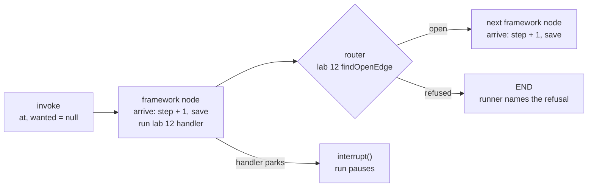
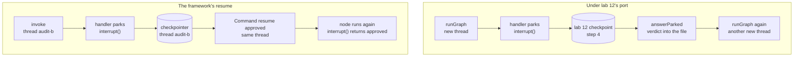

# Lesson 0020 — LangGraph.js, Evaluated

LangGraph.js runs lab 12's graph behind lab 12's own `runGraph` signature. Each lab 12 node becomes a framework node with the same name, and each gets one [[conditional-edge|conditional edge]] whose router asks lab 12's `findOpenEdge`. The node the router picks makes the move and saves lab 12's [[checkpoint]] through the port. A handler's park becomes `interrupt()`, which needs a [[checkpointer]]. Lab 12's 74 tests run in lab 13 unchanged, with lab 12's interpreter swapped out by a test-runner plugin.

Material: [open the lesson](../../lessons/0020-langgraph-js-evaluated.html) · lab: `hermes-sdk-lab/13-graph-orchestration/`, parts a to c and `pnpm test`.

## One step in lab 13



## The same pause, resumed two ways



Measured against `@langchain/langgraph` 1.4.21, `@langchain/core` 1.2.17, zod 4.4.3 and vitest 3.2.7 on Node 22.14.0, on 2026-10-22:

- Lab 12's 74 tests pass in lab 13 unchanged. Thirty of them reach `runGraph`, and 44 never call it.
- Lab 13 holds 83 tests: lab 12's 74 and 9 of its own.
- With the swap plugin removed, the two port tests fail.
- Mutations of the runner fail 2 tests (router question removed), 14 (arrival save removed) and 13 (pause bypassed).

The three runnable parts:

- Part a: the audit lands at 2 calls and 80 tokens. Lab 12's port saved 7 checkpoints and the framework saved 10.
- Part b: the held audit pauses at step 4 after one model call, and resumed with `Command({ resume: "approved" })` it lands at 2 calls and 80 tokens. Its nine-line trace walks legal and complete, and lab 12's checkpoint steps read 1, 2, 3, 4, 4, 5, 6, 7, 8.
- Part c: the resume value `"maybe"` is refused by the Zod `responseSchema`, and the [[thread]] still waits at `awaiting_approval`.

A 40-step loop lands through the runner, which raises the step limit. With the framework's default of 25 it throws `GraphRecursionError`.

## Hermes anchoring

Scenario step S3 (dispatch under the graph) now runs on a framework, with the rules still on the edges: the router asks lab 12's guards. S5 (the loop iterates) is replayed with the held call paused two ways. Under the port the verdict lives in lab 12's checkpoint file and the [[approval-queue]] reads it. Under the framework's own resume the verdict arrives in the framework's thread, and two records say the job waits. Lesson 0021 decides which record Hermes keeps.

## What the lesson does not claim

The framework's resume ran in one process, with a fresh job context standing in for a second process, because `MemorySaver` ends with the process. No durable saver was tested. The saver is a parameter, so one can be passed. The runner asks `findOpenEdge` twice for a refused move, because a router cannot write state, and this is safe only because every guard is pure. Under `Command` the paused handler runs three times, and it records nothing until the last. Lab 12's `handlers.ts` gained two exports, `jobContext` and `finishJob`, split out of its run function with no change in behaviour.

## Terms introduced

[[conditional-edge]] · [[checkpointer]] · [[thread]]

```dataview
TABLE term AS Term, category AS Category, status AS Status
FROM "wiki/terms"
WHERE type = "glossary-term" AND lesson = "0020"
SORT category ASC, term ASC
```
