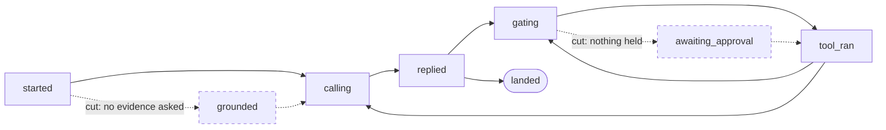
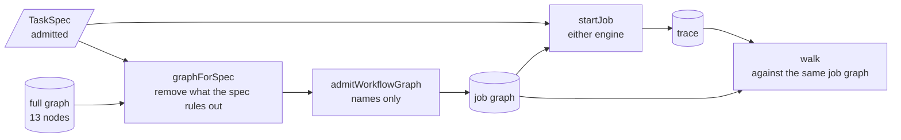

# Lesson 0021 — The Spec Decides the Graph

Lab 12 runs every job under one graph of 13 nodes and 26 edges. A [[job-graph|job graph]] is that full graph without the nodes and edges one job's [[task-spec|TaskSpec]] makes unreachable. The function `graphForSpec` builds it before the job starts, and the result goes through `admitWorkflowGraph`, the strict parse the graph file goes through. A move the job graph lacks is refused on either engine. The lesson ends with the course's first [[architecture-decision-record|architecture decision record]], which skips LangGraph.js and keeps the port.

Material: [open the lesson](../../lessons/0021-the-spec-decides-the-graph.html) · lab: `hermes-sdk-lab/13-graph-orchestration/`, parts d and e and `pnpm test` · decision: `docs/adr/0001-skip-langgraph-js-keep-the-port.md`.

## The audit's job graph



Dashed parts are in the full graph and not in the audit's. The edges to the five failure outcomes are left out of the drawing.

## One spec feeds the graph and the run



## The three rules

| Spec field | Value | Removed | Why no run of this job needs it |
|---|---|---|---|
| `approvalRequired` | empty | `awaiting_approval`, 5 edges | the gate answers `hold` only for a tool on this list |
| `evidenceQueries` | empty | `grounded`, 4 edges | `started` moves to `grounded` only when a pack answers the spec's queries |
| `evidenceQueries` | listed | the edge `started` to `calling` | with queries listed and no pack, `started` ends at `no_evidence` |
| `allowedTools` | empty | nothing | the model may still name a tool, and the gate must refuse it |

Measured against `@langchain/langgraph` 1.4.21, `@langchain/core` 1.2.17, zod 4.4.3 and vitest 3.2.7 on Node 22.14.0, on 2026-10-30:

| Graph | Nodes | Edges | [[guard\|Guards]] |
|---|---|---|---|
| full, lab 12's file | 13 | 26 | 6 |
| the audit | 11 | 17 | 3 |
| the audit with `graph_health` held | 12 | 22 | 6 |
| the audit with two evidence queries | 12 | 20 | 3 |

| Run | Result | Cost before the refusal |
|---|---|---|
| a held spec on the audit's job graph | `no_edge` from `gating` to `awaiting_approval`, step 4 | 1 model call, 4 trace lines, last checkpoint at `gating` |
| no pack on the evidence job's graph | `no_edge` from `started` to `calling`, step 1 | 0 model calls, 1 trace line |

Both refusals happen on lab 12's interpreter (`pnpm job e`) and on LangGraph.js (`pnpm test`). All seven recorded traces walk legal and complete on their own spec's job graph. The parked audit's trace is refused at line 5 on the audit's job graph.

Lab 13 holds 107 tests: lab 12's 74 and 33 of its own, 24 of them new. Each mutation of `graphForSpec` fails tests. The approval rule off fails 6, and the `grounded` rule off fails 4. The `started` to `calling` rule off fails 2, and unused guards kept fails 1.

## The decision on LangGraph.js

| Option | What it means | What lessons 0018 to 0021 measured |
|---|---|---|
| Adopt | the framework keeps the run's record and its resume | two records say a job waits, the paused node reruns, and Hermes ADR-0018 keeps job truth in Hermes's own files |
| Wrap | the framework runs behind `runGraph` | it took over traversal only: 66 lines of loop, replaced by 157 lines and two packages that bring 19 more |
| Skip | lab 12's interpreter runs the graph | resume from a checkpoint, a verdict from another process, and job graphs all work without the framework |

The record decides skip and keeps the [[port]]. The signature of `runGraph` stays the place where an engine plugs in, and lab 13's test swap can measure a later candidate.

## Hermes anchoring

Scenario step S3 (dispatch under the graph) starts from the job graph. In S5 (the loop iterates), a job that holds nothing has no approval wait. Hermes's proposed lifecycle in `hermes-job-control-plane.md` §4 says a `--no-writeback` job skips `awaiting_approval`, and lab 07's spec stands in for that flag with an empty `approvalRequired`. S2 (evidence before dispatch) becomes a missing edge from `started` to `calling`. The workflow graph stays apart from the knowledge graph and the [[trace]]: evidence queries remove a node, and their answers never enter the graph.

## What the lesson does not claim

The removal rules are facts about lab 12's handlers, checked by tests. A change to a handler could make one false, and no check ties the rules to the handlers' code. The mismatched runs stand in for a faulty gate. No writeback flag exists in the TaskSpec. Line counts leave out comments and blank lines. The 21 packages are the two pinned ones and the 19 the lockfile adds, with zod left out.

## Terms introduced

[[job-graph]] · [[architecture-decision-record]]

```dataview
TABLE term AS Term, category AS Category, status AS Status
FROM "wiki/terms"
WHERE type = "glossary-term" AND lesson = "0021"
SORT category ASC, term ASC
```
