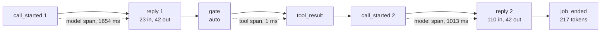
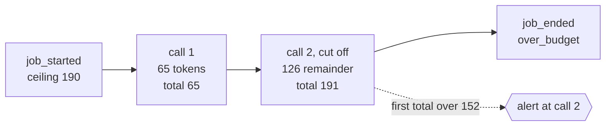

# Lesson 0022 — What the Run Cost

Every [[trace]] line records a time, and every reply records its tokens. The function `costReport` reads one trace file and returns one [[span]] per model call and per tool run. Each span carries time, tokens, and dollars from a pinned price table. It sums the spans and compares the sums with `job_ended`'s totals. It places the 80% budget alert at the call that crossed it.

Material: [open the lesson](../../lessons/0022-what-the-run-cost.html) · lab: `hermes-sdk-lab/14-reliability/`, `pnpm job` and `pnpm job --cost-report <trace.jsonl>`.

## Lines pair into spans



Solid arrows are line order. Dashed arrows are the three spans the report pairs from them.

| Span | Starts at | Ends at | Joined by |
|---|---|---|---|
| a model call | `call_started` | the `reply` with the same `call` | the call number, on both lines |
| a cut-off model call | `call_started` | `job_ended` | no reply has that call number |
| a tool run | the `gate` line | the `tool_result` for the same tool | line order, because the gate line holds no tool-call id |
| a wait for a verdict | a `gate` that answered `hold` | the `approval` line | kept inside the tool span as `heldMs` |

## The sums agree with the record

Measured on 2026-10-30 with zod 4.4.3, vitest 3.2.7 and tsx 4.23.1 on Node 22.14.0, priced as claude-opus-4-8 at $5 and $25 per million tokens:

| Recording | Sum of spans | `job_ended` | Dollars |
|---|---|---|---|
| audit-atlas | 217 | 217 | $0.002765 |
| tight-budget | 65 + 126 remainder | 191 | $0.004315 at most |
| tight-deadline | 65 + 118 remainder | 183 | $0.004115 at most |
| tight-deadline-resume | 183 carried + 152 | 335 | $0.001600 this run |
| audit-atlas-grounded | 494 | 494 | $0.004150 |
| audit-atlas-bare | 236 | 236 | $0.002860 |
| parked-audit | 80 | 80 | $0.000800 |

A cut-off call has no reply line, so its tokens are `job_ended`'s total minus everything else. The supervisor wrote that total from its own estimate, so the report marks the call `source: "remainder"`. A remainder that would fall below zero is booked as zero, and the totals then miss the record. On the two runs with a cut-off call the totals match by construction, so that floor is their only token check. With no input and output split, a remainder is priced at the output rate, which gives an upper bound.

## The pack's share and the alert

The [[context-pack|Context Pack]] sits in the first turn, and every call resends it. The trace records its 509 characters, so the report estimates 128 tokens per call at the mock's rule of four characters per token. Lesson 0016's paired runs measured 129.



The tight budget's alert line is 152 tokens, and the report places the alert at call 2. That placement rests on the estimated remainder, and the report says so. On all seven recordings, the report places an alert exactly where `job_ended` noted one.

Lab 14 holds 27 tests. Each mutation of `costReport` fails tests. The zero floor removed fails 1, and the remainder not booked fails 5. An alert that skips estimated calls fails 2, and a tool span that starts after the wait fails 1. A join that gives every held gate the newest verdict fails 1.

## Where it sits in Hermes OS

Scenario step S7 (the durable record) gets a reader that computes cost from it. S6 (budget enforcement) gets its alert placed at a call. S8 (landing the outputs) will link each output to its cost report in lesson 0024. Hermes's job ceilings are in dollars with an alert at 80% (ADR-0007, *accepted*). The course's ceiling is in tokens, and this report is where tokens become dollars. The audit's `--cost-report` flag is *scaffolded* in the Hermes record (`hermes-job-control-plane.md` §8).

## Limits

The recordings ran against the mock and the fake, so their dollars are prices for imitation tokens. No trace line names a model, so the model priced is the caller's claim. The pack's tokens are an estimate on any provider. The supervisor checks an estimate during a call, and the report checks recorded counts, so close to the line the two could disagree. The recorded traces are gitignored, so the tests depend on local files, as lab 12's and lab 13's already do.

## Terms introduced

[[span]]

```dataview
TABLE term AS Term, category AS Category, status AS Status
FROM "wiki/terms"
WHERE type = "glossary-term" AND lesson = "0022"
SORT category ASC, term ASC
```
