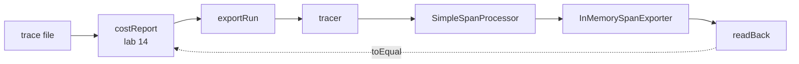
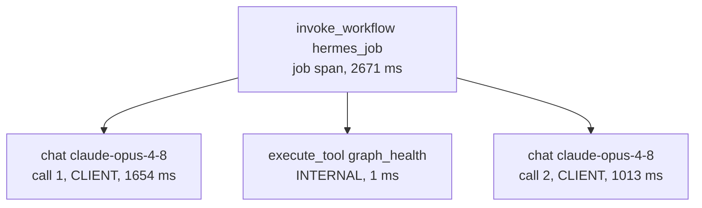

# Lesson 0023 — OpenTelemetry, Evaluated

Lesson 0022 built [[span|spans]] by hand. Lab 15 emits the same spans through OpenTelemetry JS into an in-memory [[exporter]]. It reads them back and tests them equal to lab 14's on all seven recorded runs. The decision is [[architecture-decision-record|ADR 0002]]: adopt [[otlp|OTLP]] as the export format, and keep the [[trace]] file as the record.

Material: [open the lesson](../../lessons/0023-opentelemetry-evaluated.html) · lab: `hermes-sdk-lab/15-opentelemetry/`, `pnpm job` and `pnpm job --otlp <trace.jsonl>` · decision: `docs/adr/0002-adopt-otlp-as-the-export-format.md`.

## Two routes to the same spans

The dashed arrow is the test that compares them. `exportRun` calls `costReport` first, so lab 14 still decides what a step is.

| Word | In this course | In OpenTelemetry |
|---|---|---|
| trace | the JSON Lines file of one job's events | the spans that share one `traceId` |
| span | lab 14's `ModelSpan` or `ToolSpan`, computed from two lines | an object with ids, a parent, times and attributes |
| event | one trace line, such as `reply` | a named, timed note inside a span, from `addEvent` |

## What moved, and what did not

Measured on 2026-10-30 with `@opentelemetry/api` 1.9.1, `@opentelemetry/sdk-trace` 2.12.0, `@opentelemetry/resources` 2.12.0, `@opentelemetry/otlp-transformer` 0.223.0, zod 4.4.3, vitest 3.2.7 and tsx 4.23.1 on Node 22.14.0:

| Layer | Moved into the library? | Measured by |
|---|---|---|
| span and trace ids | yes, random and new on every export | two exports of one file share no id |
| parent links | yes, from the context passed to `startSpan` | pass no context, and every step becomes a root (7 tests fail) |
| time format | yes, `[seconds, nanoseconds]` | round to the second, and 7 read-backs fail |
| export | yes, processor, exporter and the OTLP body | a batch processor holds spans, and 23 tests fail |
| which lines make a step | no, `costReport` decides | `exportRun` calls it first |
| dollars, remainder, the alert's call | no, `costReport` decides | the alert becomes a span event at call 2 |
| the record | no, the trace file | ids differ per export |

A span with a given start and no given end ends at `Date.now()`, so every end time must be passed (8 tests fail without them). The SDK's default service name is `unknown_service:` plus the Node binary's path, so lab 15 sets `service.name` to `hermes`.

Audit-atlas as four OpenTelemetry spans, all sharing one `traceId`. Every `gen_ai.*` [[semantic-convention|semantic convention]] name has status Development. Lab 15 uses 8 of them and 22 `hermes.*` names, all in `conventions.ts`. A cut-off call carries no `gen_ai.usage.*`, because the provider never reported its tokens.

## The decision

| Option | What the measurements say |
|---|---|
| Adopt as the export format | chosen: lossless on seven runs, 147 code lines, and Phoenix accepts OTLP |
| Wrap behind a port | rejected: the spans are already Hermes's own type, `CostReport`, so a port would have one adapter |
| Skip | rejected: Phoenix would need a custom importer |

Four pinned packages bring five more. Three of the five come from `otlp-transformer`, which builds the offline body and calls itself internal and experimental. The loop, labs 12 and 14, imports none of them.

## Scope and limits

- Lab 15 emits spans after the run, from the trace, and sends nothing. Nothing instruments the loop live.
- With the new packages, lab 13's `@langchain/core` resolves its optional `@opentelemetry/api` peer. Lab 13's 107 tests still pass.
- The recorded traces are not committed to git, as in labs 12 to 14.

## Terms

New: [[exporter]] · [[otlp]] · [[semantic-convention]]. Reprise: [[span]] · [[trace]] · [[architecture-decision-record]] · [[context-pack]].

**Scenario steps:** S7 (the durable record) gets an export trace viewers read. S6 (budget enforcement) gets its alert as a span event.
