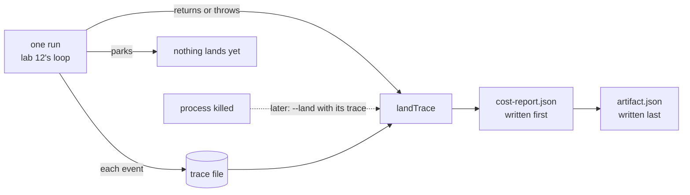
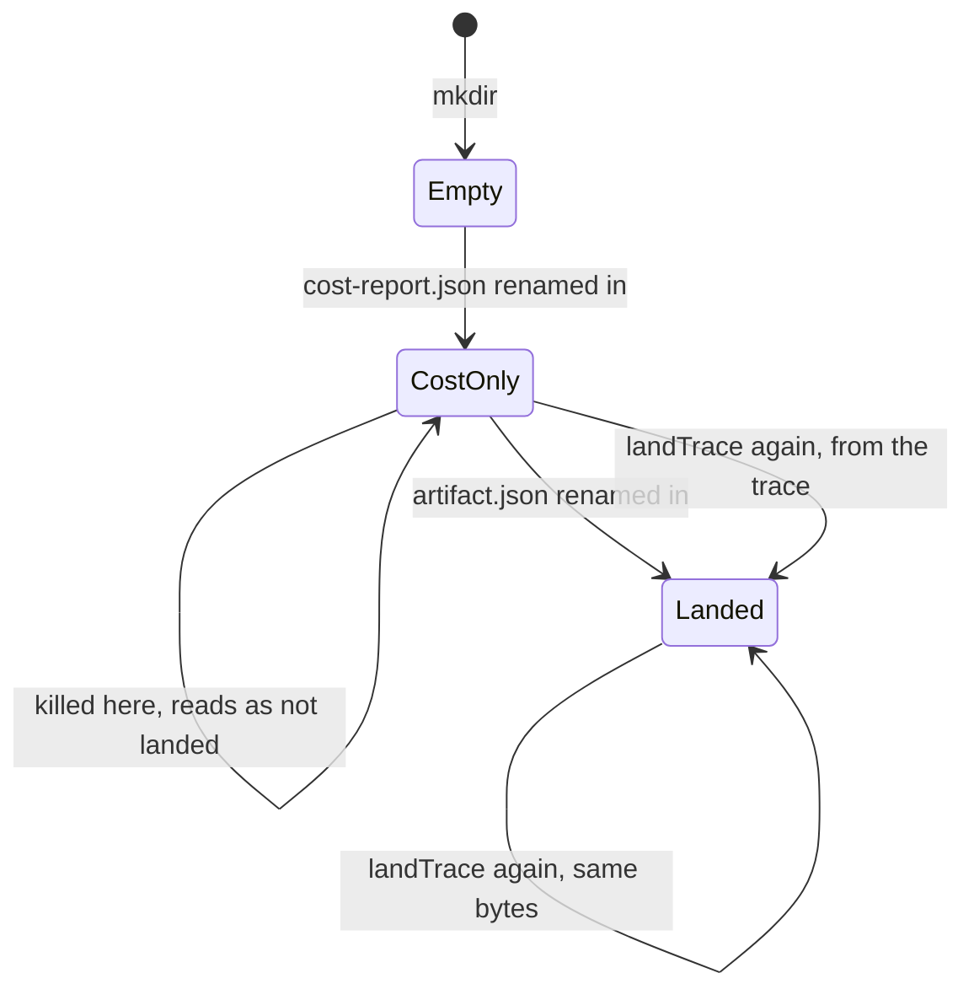

# Lesson 0024 — Landing the Outputs

Every run leaves one [[artifact]]: a folder under `artifacts/<run>/` with its output, its status, and links to its [[trace]] and its cost report. The artifact is computed from the trace file, so a run whose process died can land later. A parked run has not ended, so it lands nothing yet. Each file is an [[atomic-write|atomic write]], and `artifact.json` is written last.

Material: [open the lesson](../../lessons/0024-landing-the-outputs.html) · lab: `hermes-sdk-lab/14-reliability/`, `pnpm job --land` and `pnpm job --land <trace.jsonl>`.

## Every path goes through the trace file



`runAndLand` writes each event to the trace file, then calls `landTrace` when the run returns or throws. A killed process runs no more code, so `pnpm job --land <trace.jsonl>` lands its trace later, through the same function.

| How the record ends | Status | Output |
|---|---|---|
| `job_ended` says `landed` | done | the last completed reply |
| `landed`, with no completed reply | failed | none |
| another outcome, with `partialText` | failed | the partial text, marked partial |
| another outcome, no partial text | failed | none |
| no `job_ended` line | failed, outcome null | none, because streamed text lived only in memory |

Measured on 2026-10-30 with zod 4.4.3, vitest 3.2.7, tsx 4.23.1 and @types/node 22.20.1 on Node 22.14.0:

| Recording | Status | Output |
|---|---|---|
| audit-atlas | done | 81 chars |
| tight-budget | failed, `over_budget` | 46 chars, partial |
| tight-deadline | failed, `out_of_time` | 24 chars, partial |
| tight-deadline-resume | done | 81 chars |
| audit-atlas-grounded | done | 81 chars |
| audit-atlas-bare | done | 81 chars |
| parked-audit | done | 15 chars |

## A kill cannot tear the folder



A reader opens only `artifact.json`. A kill between the two writes leaves a folder that reads as not landed, and landing again from the trace completes it.

Lab 14 holds 56 tests, 29 of them new. Each mutation fails tests. `artifact.json` written first fails 1, and a write with no temporary file fails 1. No landing on a throw fails 1, and a landed park fails 1. A failed run without its partial text fails 4, and a refused trace line that is skipped fails 1. A run name checked only after the run fails 1.

## Where it sits in Hermes OS

Scenario step S8 (outputs land, linked to cost) gets its first code. S6 (the budget stops a run) keeps partial text, and now that text reaches a file. Hermes OS accepts produced artifacts in the Artifact Vault (ADR-0013) and the terminal words done and failed. Its Artifact Publisher, which links outputs to job and cost, is scaffolded. It also accepts kill at the ceiling, partial kept, marked failed (ADR-0007), and zero writeback in Wave 1.

## Limits

- No trace line names the job, so a run and its resume land as two folders named after their trace files.
- The trace alone cannot tell a dead run from a parked one, and `runAndLand` can, because lab 12 returns a typed park.
- The spec's `outputPath` stays unread, and the folder is per run, since one path per spec would make seven audit runs share a file.
- Nothing lands a killed process on its own: you run `pnpm job --land` with its trace file.
- The recorded traces and the landed folders are not committed to git.

## Terms introduced

[[artifact]] · [[atomic-write]]

```dataview
TABLE term AS Term, category AS Category, status AS Status
FROM "wiki/terms"
WHERE type = "glossary-term" AND lesson = "0024"
SORT category ASC, term ASC
```
