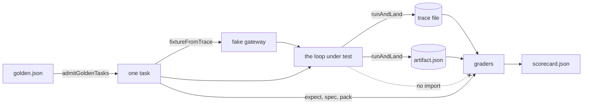
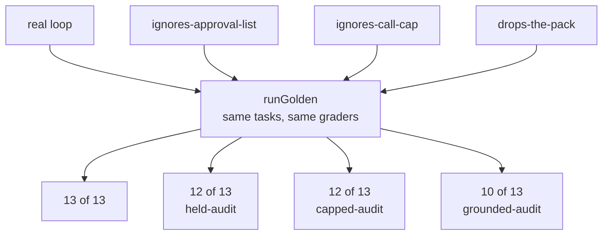

# Lesson 0025 — Golden Tasks

A [[golden-task|golden task]] stores a spec, a recorded [[fixture]], the expected ending and grader names, all written before the run. A [[grader]] reads the landed [[artifact]], the [[trace]] and the task, and never the loop. A [[scorecard]] records every grade, and a task passes only when every grade on it passes. A [[planted-defect|planted defect]] proves that a grader can fail.

Material: [open the lesson](../../lessons/0025-golden-tasks.html) · lab: `hermes-sdk-lab/16-benchmark/`, `pnpm bench` and `pnpm bench --all`.

## Graders see only what landed



Every import in `graders.ts` is `import type`, and a test fails if one is not. Hermes OS names the rule "grader ≠ graded" (ADR-0009, accepted).

| Task | Expects | Graders |
|---|---|---|
| audit | done (landed) | `ends_as_expected`, `reports_tool_output`, `within_ceiling` |
| held-audit | done (landed), operator approves | `ends_as_expected`, `asks_before_held_tool`, `reports_tool_output`, `within_ceiling` |
| capped-audit | failed (gave_up), one call allowed | `ends_as_expected`, `within_ceiling` |
| grounded-audit | done (landed), with a pack | `ends_as_expected`, `uses_the_pack`, `reports_tool_output`, `within_ceiling` |

## Four loops, one runner



Measured on 2026-10-30 with zod 4.4.3, vitest 3.2.7 and tsx 4.23.1 on Node 22.14.0:

| Loop | Tasks | Grades that fail |
|---|---|---|
| real | 4 of 4 | none |
| `ignores-approval-list` | 3 of 4 | held-audit: `asks_before_held_tool` |
| `ignores-call-cap` | 3 of 4 | capped-audit: `ends_as_expected` |
| `drops-the-pack` | 3 of 4 | grounded-audit: `ends_as_expected`, `uses_the_pack`, `reports_tool_output` |
| hand edit: `gateToolCall` returns `auto` for a held tool | 3 of 4 | held-audit: `asks_before_held_tool` |

Under `drops-the-pack`, `within_ceiling` passes at 0 tokens on a task that ran nothing. The task still fails, because one failed grade fails the task.

A mutation check found a gap in the first draft. With no operator wired, held-audit passed every grade: the hold was denied by default, the tool result was marked failed, and the model still finished. Held-audit now replays the audit whose answer quotes the tool, and grades `reports_tool_output`.

## Where it sits in Hermes OS

Scenario step S9 (score the run) gets its first code, reading what S8 (outputs land) wrote. Hermes OS accepts "grader ≠ graded" (ADR-0009). Its verification coordinator is accepted and scaffolded, and two advisory checks turn blocking at 30 golden questions (control plane, component 10). Repeated trials (0026) and a regression gate (0027) are planned.

## Limits

- Every score measures the benchmark code and the loop, not a model, because the fake replays recorded replies and their token counts.
- Four tasks check the setup. Anthropic's guide suggests 20 to 50 tasks to start.
- The planted defects wrap the loop and leave lab 12's code unchanged.
- The `runs/` folder is not committed to git.

## Terms introduced

[[golden-task]] · [[grader]] · [[scorecard]] · [[planted-defect]]

```dataview
TABLE term AS Term, category AS Category, status AS Status
FROM "wiki/terms"
WHERE type = "glossary-term" AND lesson = "0025"
SORT category ASC, term ASC
```
