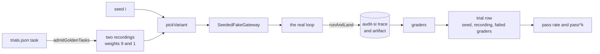
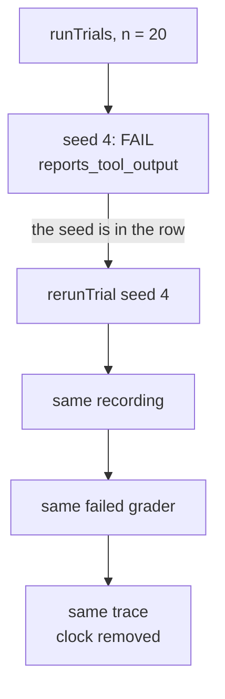

# Lesson 0026 — Many Runs, One Verdict

A [[trial]] is one graded run of one task, and one trial is one sample. A [[seeded-fake|seeded fake]] replays one of several recordings, picked by a seed, so the failure rate is set in the task file before any run. The [[pass-rate|pass rate]] says how often a task passes. [[pass-hat-k|pass^k]] says whether k trials all pass, and [[pass-at-k|pass@k]] whether at least one does. A failed trial reruns exactly from its seed.

Material: [open the lesson](../../lessons/0026-many-runs-one-verdict.html) · lab: `hermes-sdk-lab/16-benchmark/`, `pnpm trials`, `pnpm trials --rerun audit --seed 4`, `pnpm trials --settle`.

## Trial i uses seed i



| Task in `tasks/trials.json` | Recordings | Measured at n = 20, k = 4 |
|---|---|---|
| audit | `audit-atlas.jsonl` weight 9, lab 12's `parked-audit.jsonl` weight 1 | 19 of 20, pass rate 0.95, pass^4 0.800. Seed 4 fails `reports_tool_output` |
| grounded-audit | its one recording | 20 of 20, pass^4 1.000. Every trial is identical |

## A failed trial runs again



## Measured, 2026-10-31

Ten series of 400 audit trials, true pass rate 90%, with zod 4.4.3, vitest 3.2.7 and tsx 4.23.1 on Node 22.14.0:

| | Lowest | Highest |
|---|---|---|
| pass rate after 10 trials | 70.0% | 100.0% |
| pass rate after 100 trials | 87.0% | 95.0% |
| trials until the rate stays within 10 points | 1 | 35 |
| trials until the rate stays within 5 points | 7 | 106 |

All 4,000 trials: 3,614 passed (90.3%). pass^1 0.903, pass^2 0.816, pass^4 0.666, pass^8 0.444, against 0.9^k = 0.900, 0.810, 0.656, 0.430.

## Where it sits in Hermes OS

Scenario step S9 (score the run). The Hermes OS README says a promotion needs at least ten consecutive clean runs and a signed ADR. No PDR or ADR text states the number, so the claim is illustrative only. That rule is a pass^10 question. A committed baseline and a regression gate (0027) are planned.

## Limits

- Every number measures the benchmark code at a failure rate the task file sets. No model ran.
- A live model's failures are not drawn from two recordings, and its trials may not be independent.
- The command `pnpm trials` runs the real loop only. The function `runTrials` accepts any `NamedLoop`.

## Terms introduced

[[trial]] · [[seeded-fake]] · [[pass-rate]] · [[pass-hat-k]] · [[pass-at-k]]

```dataview
TABLE term AS Term, category AS Category, status AS Status
FROM "wiki/terms"
WHERE type = "glossary-term" AND lesson = "0026"
SORT category ASC, term ASC
```
