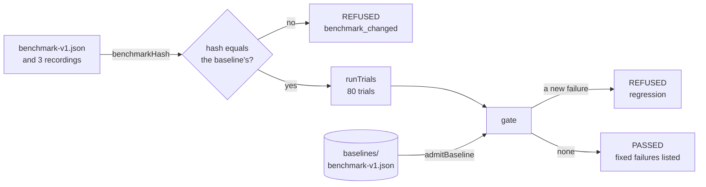
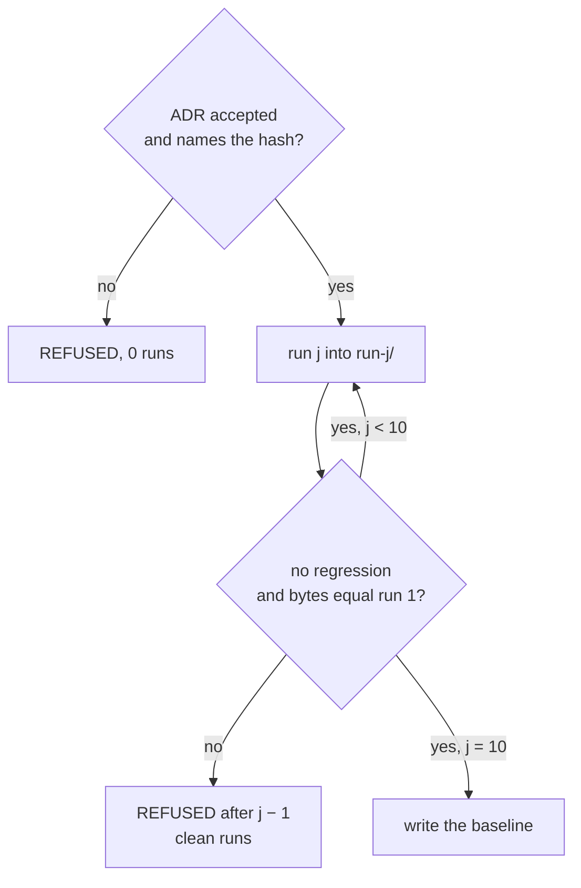

# Lesson 0027 — The Regression Gate

A [[benchmark]] is a fixed set of golden tasks, their recordings, and the trial counts n and k, named and hashed. The [[baseline]] is the committed scorecard that every later change is compared with. A [[regression]] is a trial failure the baseline does not list. The [[regression-gate|regression gate]] refuses any change that has one. A [[promotion]] replaces the baseline after ten clean runs and an accepted ADR.

Material: [open the lesson](../../lessons/0027-the-regression-gate.html) · lab: `hermes-sdk-lab/16-benchmark/`, `pnpm gate`, `pnpm gate --defect <name>`, `pnpm gate --promote --adr <path>` · decision: `docs/adr/0003-freeze-benchmark-v1-as-the-baseline.md`.

## The hash first, then the trials



| Measured, `pnpm gate` | Verdict |
|---|---|
| the real loop | passed: audit 19 of 20, the rest 20 of 20 |
| `ignores-approval-list` | refused: 20 regressions, held-audit, `asks_before_held_tool` |
| `ignores-call-cap` | refused: 20 regressions, capped-audit, `ends_as_expected` |
| `drops-the-pack` | refused: 60 regressions, grounded-audit, three graders |
| lab 07 `gateToolCall` edited to return `auto` for a held tool | refused: the same 20 regressions as `ignores-approval-list` |
| audit weight 9 changed to 3 | refused before any trial: `benchmark_changed` |

## Promotion



| Measured | Result |
|---|---|
| ADR 0003 at status proposed | refused after 0 runs |
| the real loop, after the user accepted ADR 0003 | promoted after 10 clean runs, about 20 s |
| `drops-the-pack-after-200`, one `pnpm gate` | passed |
| `drops-the-pack-after-200`, `--promote` | refused after 2 clean runs: run 3 has 60 regressions |

## Where it sits in Hermes OS

Scenario step S9 (score the run). The Hermes OS README, Guarantees, says promotion requires at least ten consecutive clean runs plus a signed ADR. No PDR or ADR states the number, so the claim is illustrative only. ADR 0003 applies the rule to the course's own baseline and names `benchmark-v1` as what Phase 5 answers to. Phase 6 needs a live run of the same tasks.

## Limits

- Every number measures the benchmark code and the loop on a seeded fake. No model ran.
- The gate pairs trials by seed. A live model allows no such pairing, so a live gate needs a tolerance.
- On a fake, ten clean runs show that no state leaks between runs. pass^10 for a 90% task, from lesson 0026's 4,000 trials, is 0.362.

## Terms introduced

[[benchmark]] · [[baseline]] · [[regression]] · [[regression-gate]] · [[promotion]]

```dataview
TABLE term AS Term, category AS Category, status AS Status
FROM "wiki/terms"
WHERE type = "glossary-term" AND lesson = "0027"
SORT category ASC, term ASC
```
